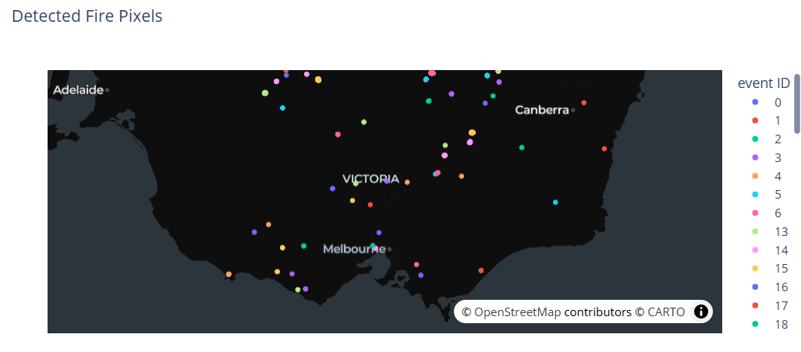
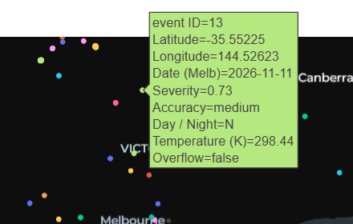
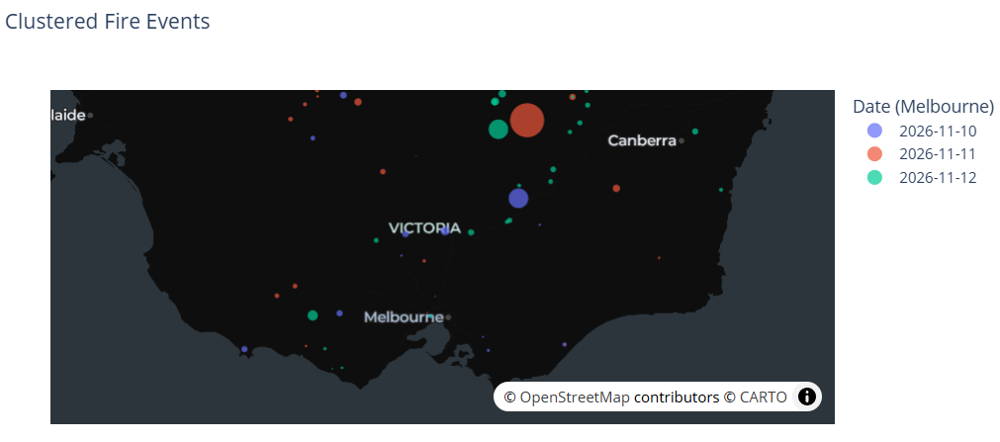
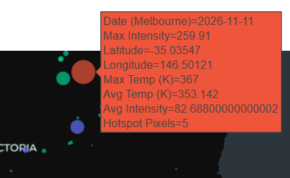

# Project Title
Fire Monitoring in Victoria/Australia

## Description
This data science project cleans, analyses, and viusalises fire spots in Victoria and Australia over the past 60-90 days as historical data and last 3 days for recent data. The data comes from NASA's FIRMS (Fire Information for Resource Management System) using two satellites that passes Australia twice a day, VIIRS NOAA-20 & VIIRS NOAA-21. The data is then used to predict future condition of the existing fire spots up to 3 days.

## Features
- Fire map of individual and grouped fire spots
- Timeline of fire data
- Prediction of future fire activities from existing fire events
- Visualisations streaming for better display

__Firespots Mapping__

__Firespots Mapping - Spot Hovered__

__Clustered Events__

__Clustered Events - Spot Hovered__

## Future developments
- Global fire hotspots instead of limited to Australia/Victoria
